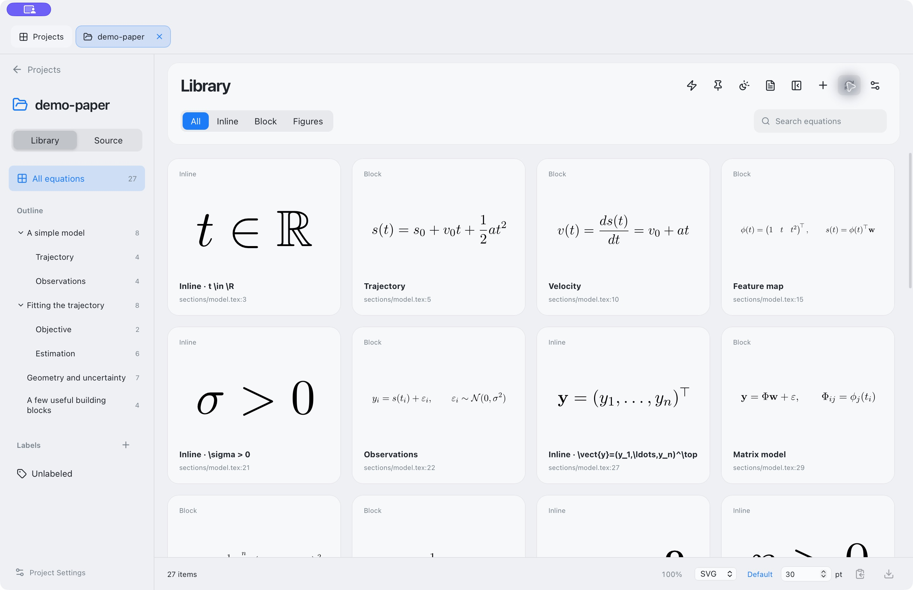

# FerMatter

<picture>
  <source media="(prefers-color-scheme: dark)" srcset="site/public/assets/fermat-dark.svg">
  
</picture>

- Bring equations from a LaTeX or Typst paper into your presentation.
- Browse equations and TikZ/CeTZ drawings; edit slide-specific variants; copy/export SVG, PDF, PNG, or JPEG.
- Unnotarized public preview for **Apple Silicon Mac (macOS 14+)**.

## Start here

| Task | Read |
| --- | --- |
| Install | [DMG or Homebrew](https://fermatter.github.io/download/) |
| Use the app | [Guide](user-docs/README.md) · [Features](https://fermatter.github.io/features/) |
| Install rendering tools | [LaTeX and Typst requirements](user-docs/requirements.md) |
| Connect an agent | [MCP guide](user-docs/automation.md) |
| Request a feature or report a bug | [GitHub Issues](https://github.com/k-onoue/FerMatter/issues) |

## Included demos

Four editable projects are included under **Demos**: [LaTeX](examples/demo-paper/), [Typst](examples/demo-typst/), [TikZ](examples/demo-tikz/) and [CeTZ](examples/demo-cetz/).

For maintainers: [Development docs](dev-docs/README.md).

## License

- [Apache License 2.0](LICENSE); copyright and attribution: [NOTICE](NOTICE).
- The license does not grant trademark permission; do not distribute modified builds under the FerMatter name or icon.
- External tools retain their own licenses and are not bundled.
