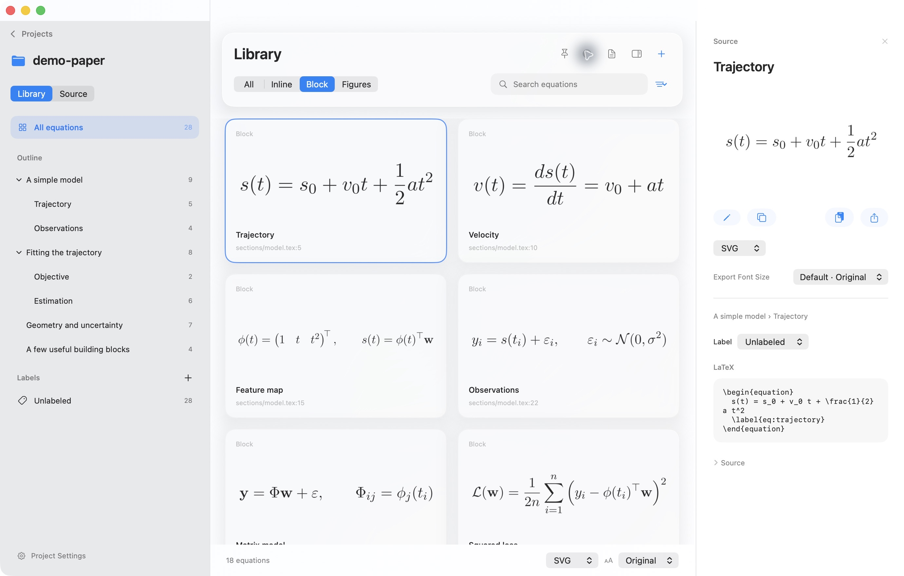

# Mathlidelux

**From your paper. Into your next talk.**

A native macOS app for turning equations from a LaTeX or Typst project into a searchable
library of SVGs for presentations. TikZ and CeTZ drawings are supported too.



- Open a LaTeX or Typst folder, main file, or ZIP. Each project keeps its own format and definitions.
- Paste equations into a new project, using a built-in or custom template.
- Browse the source document’s heading hierarchy; search equations and add your own labels.
- Browse TikZ and CeTZ figures alongside equations, preserving their colors.
- Navigate between a compiled PDF, its source outline, and equation cards.
- Edit project files in Source mode, with a Finder-style file tree, outline, tabs, nested right/down splits, line numbers, highlighting, project-aware completion, and configurable auto save.
- Select cards with Command-click, Shift-click, Command-A, or a selection rectangle; export or label the selection together.
- Use familiar keyboard shortcuts or customize them in Settings.
- Double-click to create a presentation version without rewriting the manuscript.
- Choose an output size and SVG (default), PNG, JPEG, or PDF; copy or drag from cards and previews.
- Complete LaTeX/Typst commands as you type, including local project definitions; move between argument fields with Tab.
- Use native Liquid Glass controls, light/dark appearances, and an always-on-top window.
- Adjust background opacity while keeping text and equations opaque.

## Status

This is a **development prototype**, targeting **macOS 26+ on Apple Silicon**.
There is no signed, notarized public download yet. Python and the selected compiler (TeX or Typst), plus TeX SVG conversion
tools where needed are currently external dependencies; they are not bundled with the app.
See [build and usage instructions](macos-app/README.md).

## Start a project

| What you have | Where to start |
| --- | --- |
| A LaTeX or Typst project folder, ZIP, or main `.tex` / `.typ` file | **Open Project** (Command-O), including projects you have never opened in Mathlidelux before. |
| Equations or source text to paste into a new project | **New Project** (Shift-Command-N): choose a template, paste, then **Create Project**. |
| A text file to use as the content of a new project | **New Project → Load File…**: load a UTF-8 `.tex`, `.typ`, or `.txt` file into the text area, then **Create Project**. |

**Load File…** replaces manual copying and pasting; it reads one file's text.
It leaves that file unchanged and creates a separate project only when you click
**Create Project**. Use **Open Project** to keep an existing project's companion
files, imports, images, and configuration together.

Built-in templates are **LaTeX**, **Typst**, **LaTeX + TikZ**, and **Typst + CeTZ**.
Choose the format your equations use; the drawing variants also load TikZ or
CeTZ. Save your own packages and macros in **Settings → Templates**.
See the [project and template guide](macos-app/README.md#start-a-project) for input
modes, examples, and custom templates.

## Try the sample

Choose **Open Project** and select [`examples/demo-paper/`](examples/demo-paper/).
The fictional teaching note contains 27 equations across four sections. It uses only synthetic
prose and standard textbook mathematics.

The same project is available as a [ZIP](docs/downloads/demo-paper.zip).
A separate [Typst sample](examples/demo-typst/) contains 20 equations, includes,
imports, and definitions ([ZIP](docs/downloads/demo-typst.zip)).
Try the separate [TikZ](examples/demo-tikz/) and [CeTZ](examples/demo-cetz/) drawing
samples, each with two figures and one equation.
All public fixtures and screenshots use synthetic sample material.

## Repository layout

| Path | Purpose |
| --- | --- |
| `macos-app/` | SwiftUI application, local LaTeX/Typst workers, tests, and build script |
| `docs/` | Static product page, ready for GitHub Pages |
| `examples/demo-paper/` | Public demonstration LaTeX project |
| `examples/demo-typst/` | Public demonstration Typst project |
| `scripts/` | Sample packaging and local publication checks |

## Preview the product page

From the repository root:

```sh
python3 -m http.server 4174 --bind 127.0.0.1 --directory docs
```

Open [localhost:4174](http://localhost:4174). No npm install or site build is needed.
The page works at a GitHub Pages project subpath and uses no CDN fonts or analytics.

## Prepare to publish

[**PUBLISHING.md**](PUBLISHING.md) covers the GitHub Pages settings, release link
configuration, and remaining work for a distributable Mac build.

Before staging files:

```sh
python3 scripts/prepare-demo.py
python3 scripts/check-publication.py
git add .
git diff --cached --stat
```

A local `paper/` directory is reserved for private manuscripts and ignored by Git.
Build products, caches, credentials, and old development screenshots are excluded.
Never force-add these files. Review staged changes before committing.

## License

Mathlidelux is licensed under the [Apache License 2.0](LICENSE).
Copyright 2026 k-onoue and Mathlidelux contributors; see [NOTICE](NOTICE).

The license does not grant permission to use the Mathlidelux name or icon
(section 6). Do not distribute modified builds under the Mathlidelux name or icon.

External tools the app runs, such as TeX Live, Typst, pdf2svg, and Poppler,
are not part of this repository and keep their own licenses.
