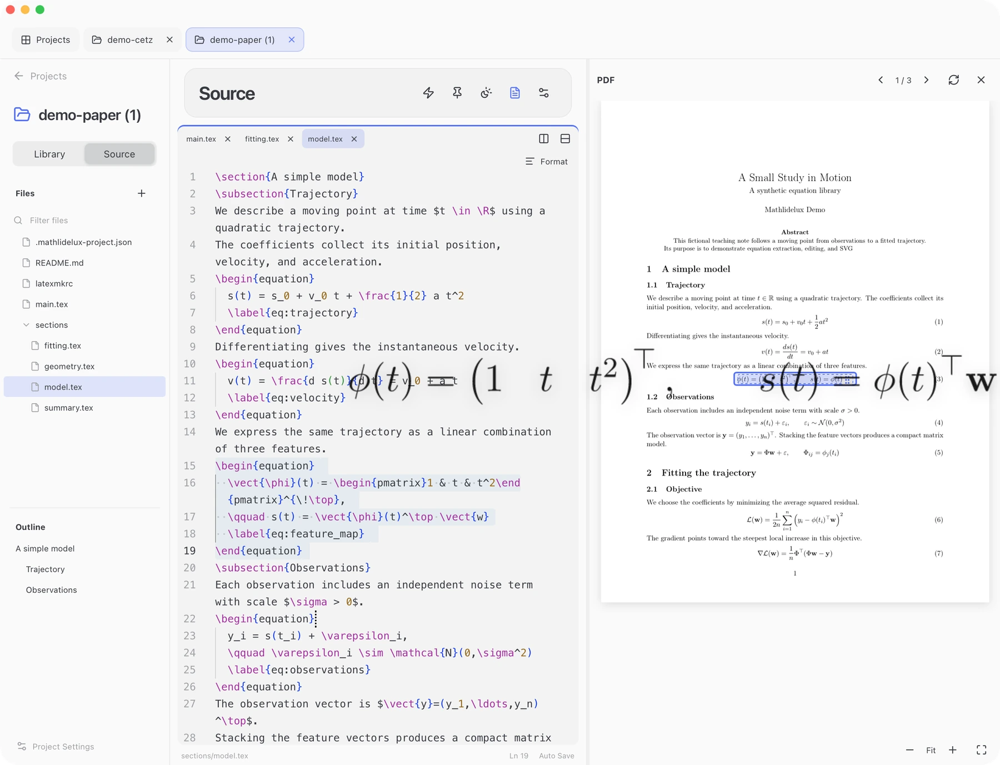

# FerMatter

<picture>
  <source media="(prefers-color-scheme: dark)" srcset="site/public/assets/fermat-dark.svg">
  
</picture>

Bring equations and diagrams from LaTeX and Typst papers into your presentations.

- **Extract & Browse:** Automatically collect equations and TikZ/CeTZ diagrams from your paper.
- **Presentation Variants:** Customize size, colors, and styles for slides without touching manuscript files.
- **Seamless Export:** Drag or copy directly into Keynote, PowerPoint, or export to SVG, PDF, PNG, and JPEG.
- **PDF & Source Sync:** Bi-directional navigation between compiled PDF and editor source via SyncTeX.
- **Local Automation:** Built-in stdio MCP server and CLI for agent workflows.

## Quick links

| Need | Resource |
| --- | --- |
| Install | [Download for macOS & Windows](https://fermatter.github.io/download/) |
| User Guide | [Documentation](user-docs/README.md) · [Features](https://fermatter.github.io/features/) |
| Compilers | [LaTeX and Typst Requirements](user-docs/requirements.md) |
| Automation | [CLI & MCP Guide](user-docs/automation.md) |
| Development | [Dev Docs](dev-docs/README.md) · [Declaration](DECLARATION.md) |
| Feedback | [GitHub Issues](https://github.com/k-onoue/FerMatter/issues) |

## Demos

Four editable projects are included under **Demos**: [LaTeX](examples/demo-paper/), [Typst](examples/demo-typst/), [TikZ](examples/demo-tikz/), and [CeTZ](examples/demo-cetz/).

## License

- [Apache 2.0](LICENSE) · [NOTICE](NOTICE).
- Trademark notice: Do not distribute modified builds under the FerMatter name or icon.
