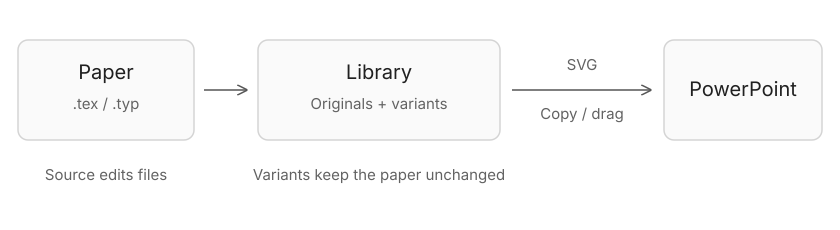

## Quick start

1. [Install FerMatter](https://fermatter.github.io/download/) and check your [compiler requirements](requirements.md).
2. Choose a default project folder on first launch.
3. Open a project or explore one of the four bundled **Demos** (LaTeX, Typst, TikZ, CeTZ).
4. See [From paper to slides](paper-to-slides.md) to extract and export equations and diagrams.

## Project management

Configure default storage in **Settings → Projects → Default project folder**. Existing projects stay in their current locations.

| Action | Behavior |
| --- | --- |
| **Open Project** (`⌘O`) | Opens an existing folder or main file in place |
| **New Project** (`⇧⌘N`) | Creates a project from a template or pasted source |
| Drop folder / Import ZIP | Copies into the default folder (or opens directly if already there) |
| **Delete** (`⌘⌫`) | Moves the source folder to Trash (macOS) |

Project tabs remember your view mode (Library or Source), open files, and PDF scroll position.

### ZIP imports

- Limits: 1 GiB per archive, 10,000 entries, 512 MiB of extracted files and 64 MiB of directory metadata.
- Multi-part archives and ambiguous ZIP end records are rejected. An otherwise valid archive can also trigger the end-record check if its comment or contents contain the same marker.
- If an archive is rejected, recreate the ZIP or extract it with your usual archive tool and use **Open Project** on the folder.

## Next steps

| Task | Guide |
| --- | --- |
| Extract, edit, and export equations and diagrams | [From paper to slides](paper-to-slides.md) |
| Image formats (SVG/PDF/PNG/JPEG), size, and color | [Size and format](export.md) |
| Filter out tables or custom environments | [Card extraction](extraction.md) |
| Keyboard shortcuts and display zoom | [Shortcuts](shortcuts.md) |
| Themes, opacity, and always-on-top | [Appearance](appearance.md) |
| Connect AI agents via MCP / CLI | [MCP](automation.md) |
| Install a newer version | [Updates](updates.md) |
| Find fixes for reported problems | [Resolved issues](https://fermatter.github.io/resolved-issues/) |
