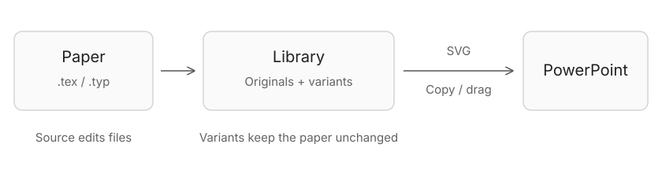

[Open a paper →](paper-to-slides.md) · [Choose size and format →](export.md)

## First launch

Choose a default project folder and review **Compiler tools**. New projects and imports use this folder; four editable demos are included under **Demos**.

[Install LaTeX or Typst](requirements.md) · [Shortcuts](shortcuts.md) · [Appearance](appearance.md) · [MCP](automation.md)
