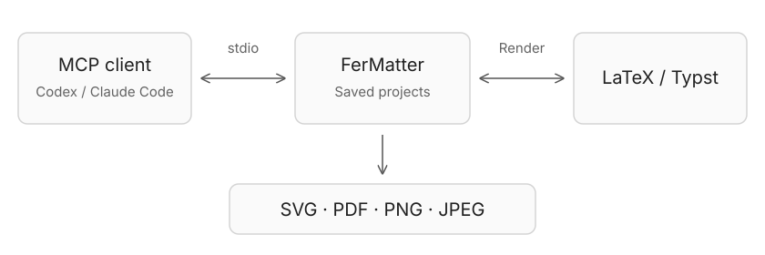

FerMatter includes a built-in stdio **MCP (Model Context Protocol)** server and CLI on macOS and Linux.

Before connecting an agent, open the project in FerMatter and verify [compiler tools](requirements.md#tool-discovery).

<span id="connect-through-mcp"></span>

## Agent setup

Use local **stdio** transport with a **300-second** timeout.

<span id="codex"></span>

### Codex (`~/.codex/config.toml`)

```toml
[mcp_servers.fermatter]
command = "/Applications/FerMatter.app/Contents/MacOS/FerMatter"
args = ["mcp"]
tool_timeout_sec = 300
```

### Claude Code

```sh
claude mcp add --transport stdio fermatter -- /Applications/FerMatter.app/Contents/MacOS/FerMatter mcp
```

<span id="check-the-connection"></span>

## Verify connection

Ask your agent:

> *"List the projects available through FerMatter MCP."*

The response will list registered projects.

<span id="available-operations"></span>

## Capabilities

| Task | What the agent can do |
| --- | --- |
| **Inspect** | List registered projects and templates; search equations and diagrams |
| **Render** | Compile arbitrary LaTeX/Typst snippets into SVG, PDF, PNG, or JPEG |
| **Export** | Batch export saved equations and diagrams directly to a folder |
| **Variants** | Create slide-specific variants without altering original files |
| **Reopen** | Reopen FerMatter SVGs inside the desktop app |

Example prompt:

> *"Find the least-squares equations in demo-paper and export them as SVG at 30 pt into /tmp."*

<span id="files-and-permissions"></span>

## Safety & scope

- MCP operates on saved project snapshots and the Library database. Save source edits before triggering agent tasks.
- Target export directories must exist and be outside project source roots.
- Agents cannot delete projects, overwrite original manuscript files, or alter app settings.
