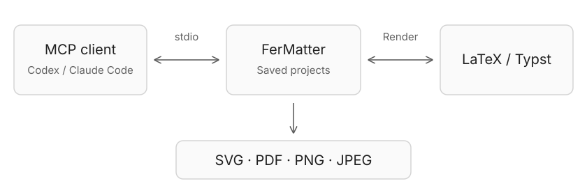

Open the project in FerMatter and configure its [compiler tools](requirements.md). MCP uses saved files; save Source edits first.

## Connect through MCP

Use local **stdio**, with a **300-second** tool timeout. Adjust the app path if installed elsewhere.

### Codex

Add to `~/.codex/config.toml`:

```toml
[mcp_servers.fermatter]
command = "/Applications/FerMatter.app/Contents/MacOS/FerMatter"
args = ["mcp"]
tool_timeout_sec = 300
```

### Claude Code

```sh
claude mcp add --transport stdio fermatter -- /Applications/FerMatter.app/Contents/MacOS/FerMatter mcp
```

## Available operations

Search Library · Render source · Export equations · Add a variant · Reopen SVG

For example: “Find the least-squares equations in demo-paper and export them as SVG at 30 pt into /tmp.”

MCP cannot edit manuscript files, delete projects or change settings. Export folders must already exist outside project source folders.
