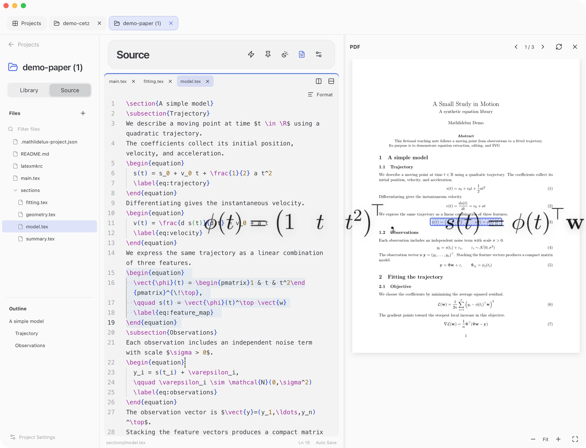

1. **Open Project** (`⌘O`): select your LaTeX or Typst folder, or try a bundled demo.
2. Select an equation in **Library**.
3. Copy (`⇧⌘C`) or drag the card into your slide. See [Choose size and format](export.md) for output settings and file export.

## Library

Use Library for slide-specific changes while keeping the manuscript unchanged.

1. Find a card using search, the document outline or the type filters.
2. Double-click it to edit the equation and preview the result.
3. **Save Variant** (`⌘S`) creates a **Custom** card; the original source card stays unchanged.

### Figures

**Figures** filters TikZ/CeTZ drawings. Edit them as Library variants, just like equations. See [output sizing](export.md#output-size) for scaling drawings and their labels.

## PDF

Use PDF to locate equations in the compiled paper.

- Open **PDF** (`⌥⌘P`). Selecting a Library card highlights its paper location.
- Click a mapped equation in the PDF to select its Library card or Source range.
- Hover over a mapped equation and drag its grab handle to use the displayed artwork in a slide.

Custom variants navigate to their original equation. Generated or ambiguous locations may have no PDF target; use the Library card or Source preview instead.

## Source

Use **Source** (`⌥⌘E`) to edit actual project files.

- Open a file from the tree. **Settings → Editor → Save files** selects automatic saving or manual `⌘S`.
- Pause inside an equation or drawing to show a caret preview. It uses open unsaved drafts without saving source files; copy or drag the preview when ready.
- Unsaved buffers survive tab/project changes and relaunches. Recovered drafts wait for an edit or explicit save. External file changes block saving until you resolve the conflict.

## Instant

Use Instant for a scratch equation without editing project files.

| Open from | Context |
| --- | --- |
| **Instant** on Projects | A standalone LaTeX, Typst, TikZ or CeTZ template |
| A project's lightning button | That project's saved definitions, imports and compiler settings; save Source edits first |

Choose **Display** or **Inline** for a math body without outer `$` or `\[...\]` delimiters:

- LaTeX: `\frac{a+b}{c}`
- Typst: `(a+b)/c`

Choose **Code** for complete environments, TikZ/CeTZ drawings or Typst markup. Use the preview with the [output controls](export.md).

Drafts and library entries save automatically. Editing updates the selected entry; **New equation** starts another, and **Duplicate equation** keeps the original. Standalone and project Instant libraries are separate.

## Refresh after changes

After changing source files, refresh each view you need:

| Action | Updates |
| --- | --- |
| **Rescan** (`⌘R`) | Library equations, drawings and outline |
| **Rebuild PDF** (`⇧⌘R`) | The document PDF and its navigation snapshot |

A failed PDF build keeps the previous document. PDF navigation and dragging use the displayed document's compiled snapshot.

For opening, creating, importing or deleting projects, see [Project folders](README.md#project-folders).

For compiler failures and extraction limits, see [Requirements](requirements.md#if-rendering-fails).
