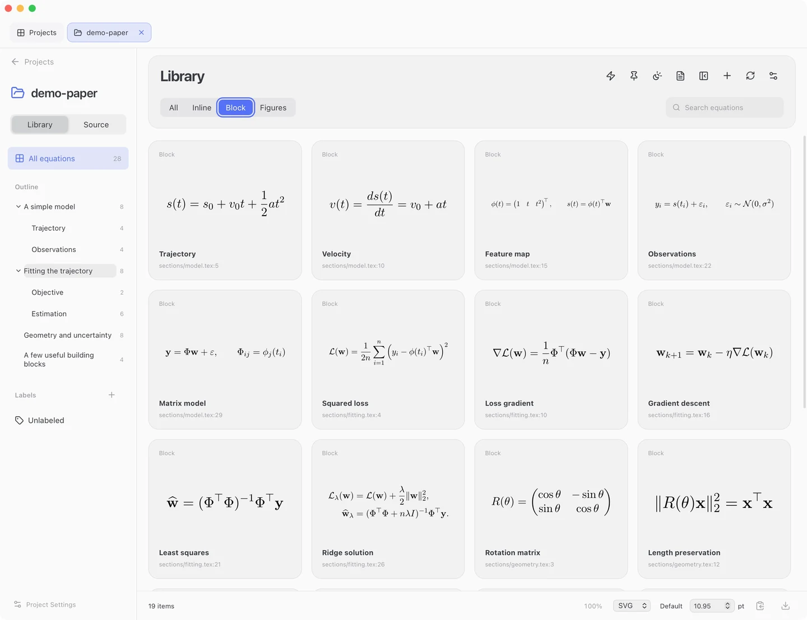
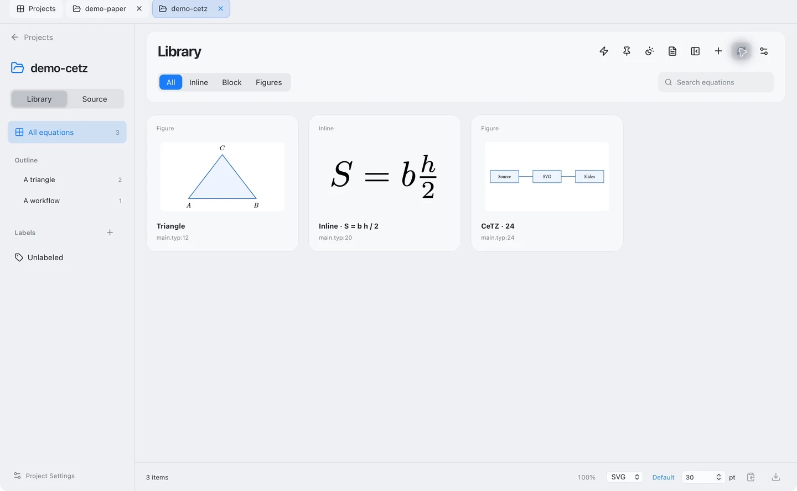
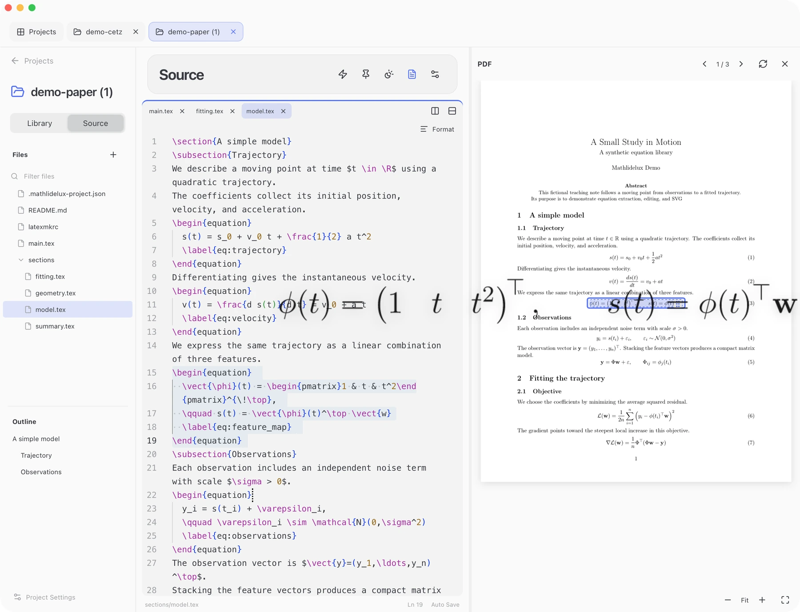
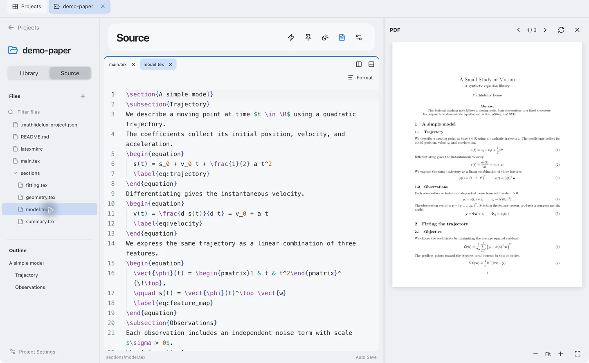
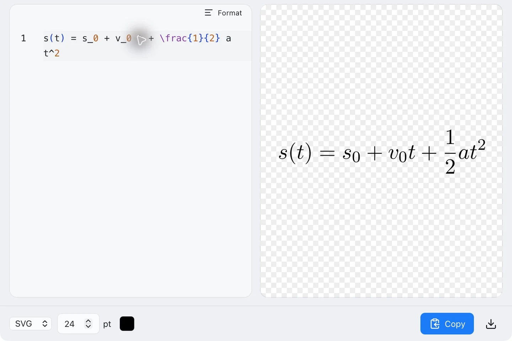

1. **Open Project** (`⌘O`): Select a LaTeX or Typst folder, or open a demo project.
2. Select an item in **Library**.
3. Copy (`⇧⌘C`) or drag the card directly into your presentation slide.

## Library

Use Library to create slide-specific variants without modifying your manuscript.

- **Search & Filter:** Find items by search, outline, or type (Inline, Block, Figures).
- **Edit Variants:** Double-click any card to customize its code, size, or color.
- **Save Variant** (`⌘S`): Creates a **Custom** card while leaving the original source intact.

### Diagrams and figures

The **Figures** filter isolates TikZ and CeTZ diagrams. Edit them as Library variants just like equations. Diagrams scale as a whole (see [output sizing](export.md#output-size)).

## PDF view

Locate and grab equations directly from the compiled paper.

- Open **PDF** (`⌥⌘P`). Selecting a Library card highlights its location in the paper.
- Click a highlighted equation in the PDF to navigate to its Library card or Source line.
- Hover over an equation in the PDF and drag its handle to drop the rendered artwork onto a slide.

## Source editor

Use **Source** (`⌥⌘E`) to edit actual project files.

- File tree, tabs, split panes, and Monaco editor with full undo/redo.
- **Settings → Editor → Save files** selects automatic saving or manual `⌘S`.
- **Caret Preview:** Placing the cursor inside an equation or diagram generates an instant preview.
- Unsaved drafts persist across tab switches and relaunches. External modifications prompt conflict resolution.

## Instant

Use Instant for quick scratchwork without touching project files.

| Source | Context |
| --- | --- |
| **Instant** on Projects screen | Standalone LaTeX, Typst, TikZ, or CeTZ template |
| Lightning button in a project | Inherits project definitions, packages, and compiler settings |

Modes:

- **Display / Inline:** Enter math bodies without outer delimiters (`$`, `\[...\]`).
- **Code:** Full environments, TikZ/CeTZ diagrams, or Typst code blocks.

Project Instant uses saved files; save Source edits first. Instant drafts save automatically. **New equation** starts another entry; **Duplicate equation** preserves the original.

## Refresh after changes

When source files change on disk, update the workspace:

| Action | Result |
| --- | --- |
| **Rescan** (`⌘R`) | Refreshes equations, diagrams, and the document outline |
| **Rebuild PDF** (`⇧⌘R`) | Recompiles document PDF and updates SyncTeX mappings |

For workspace folders, see [Project management](README.md#project-management).

For compilation troubleshooting, see [Requirements](requirements.md#if-rendering-fails).
