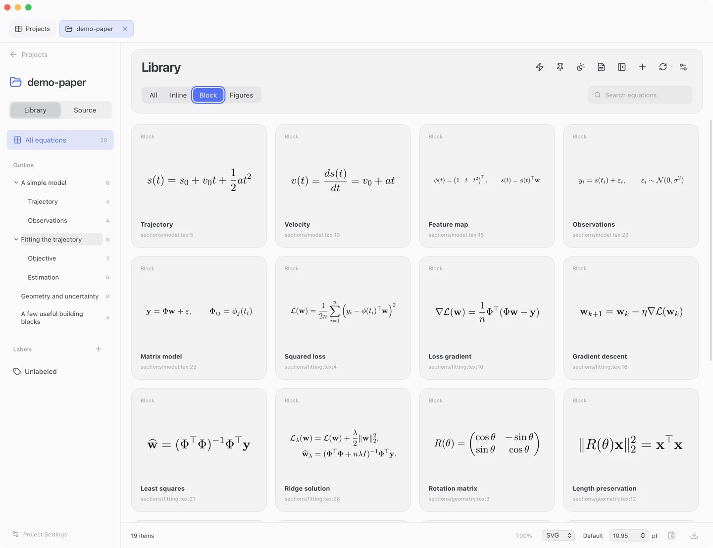
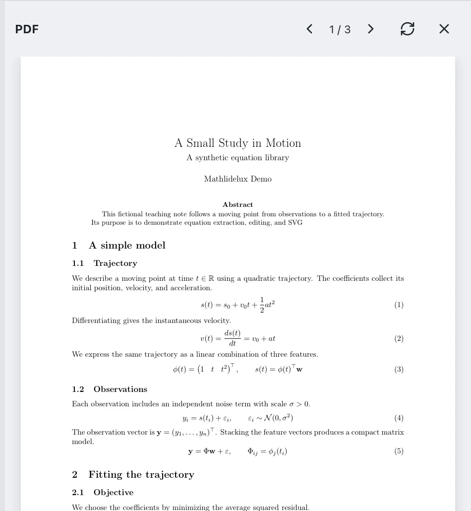
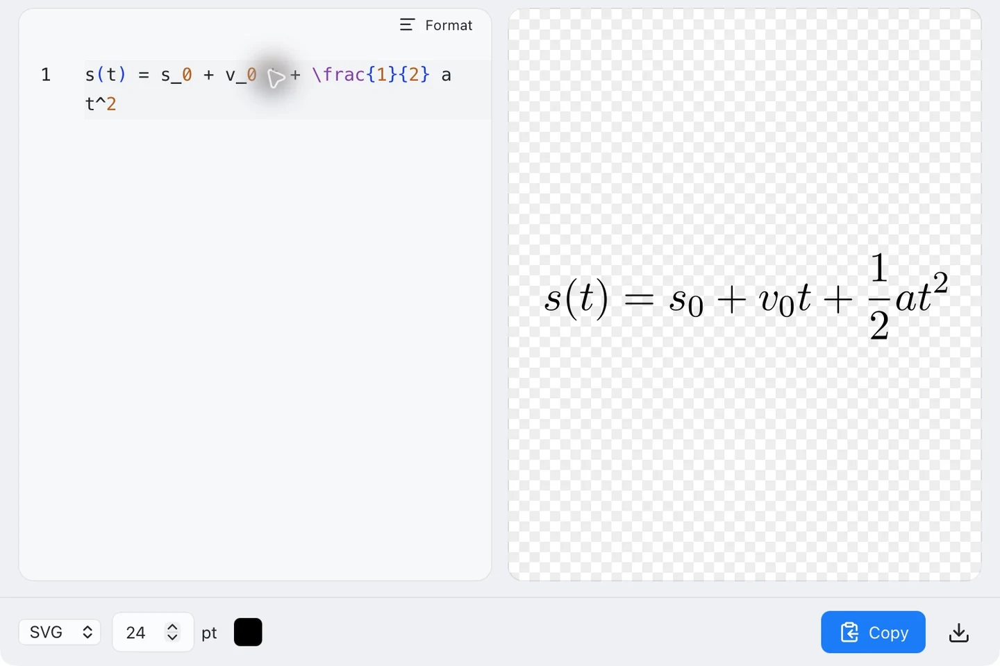
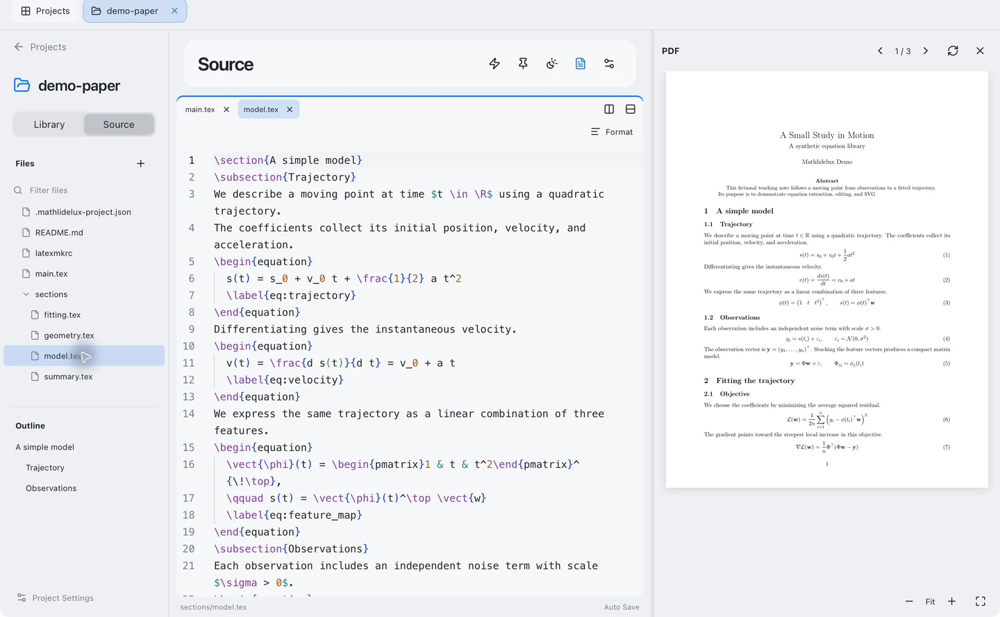
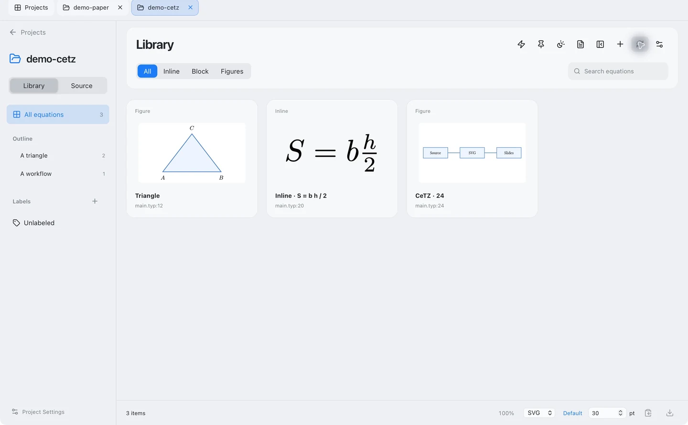

1. **Open Project** (`⌘O`): select your LaTeX or Typst folder.
2. Select a Library card; double-click to edit a presentation variant.
3. Choose **SVG**, then copy (`⇧⌘C`) or drag into PowerPoint.

## Library

**Save Variant** (`⌘S`) keeps the manuscript unchanged. [Output size and format →](export.md)

## PDF

**PDF** (`⌥⌘P`): hover over a mapped equation and drag its grab handle. Library cards, Source previews and Instant previews can also be dragged.

## Instant

Use the lightning button for the project's definitions, or **Instant** on Projects for a standalone template. Drafts save automatically.

## Source

**Source** (`⌥⌘E`) edits actual project files. **Settings → Editor** selects automatic saving or manual `⌘S`.

## Figures

**Figures** filters TikZ/CeTZ drawings. Double-click to make a presentation variant; output size scales the whole drawing.

## Project folders

| Action | Folder behavior |
| --- | --- |
| Open Project | Opens in place |
| Drop a folder / import a ZIP | Copies into the default project folder |
| Delete (`⌘⌫`) | Moves the actual source folder to Finder Trash |

## If it does not render

Check **Project Settings** (main file/compiler) and the failed item's log. After external edits, **Rescan** and **Rebuild PDF** (`⇧⌘R`). A failed build keeps the previous PDF.

[Required tools and extraction limits →](requirements.md)
