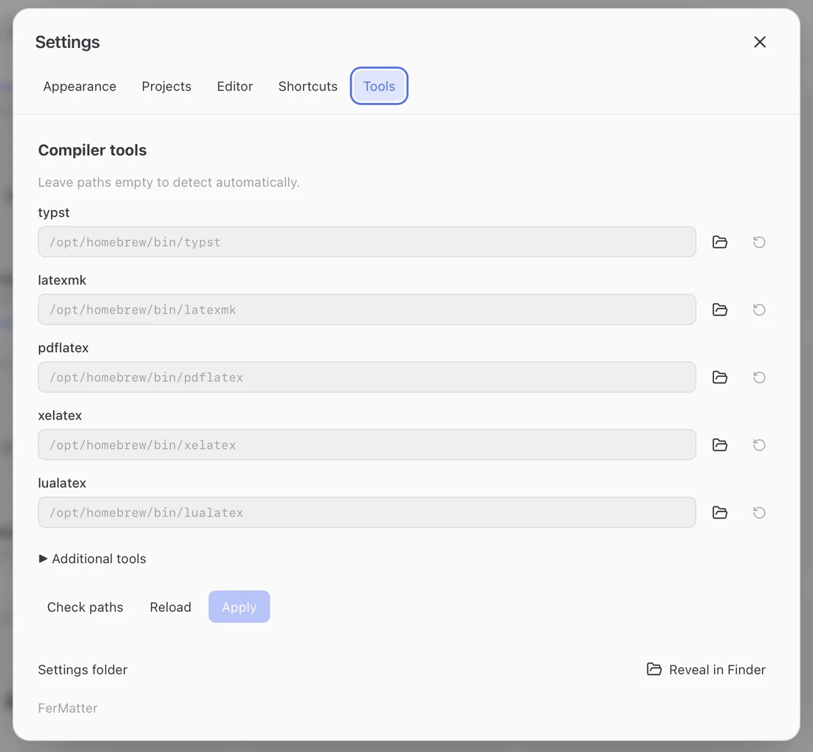

FerMatter runs on **macOS 14+ (Apple Silicon)** and **Windows 11 (x64)**. LaTeX and Typst compilers are installed separately.

Experimental Ubuntu packages: [Ubuntu installation](https://fermatter.github.io/download/#ubuntu).

## Compiler tools

Install the tools corresponding to your source documents:

| Format | Required tools | Guide |
| --- | --- | --- |
| **Typst / CeTZ** | Typst CLI 0.14+ | [macOS](https://fermatter.github.io/download/#typst) · [Windows](https://fermatter.github.io/download/#windows) |
| **LaTeX / TikZ** | TeX engine, `latexmk`, `preview.sty`, `pdfcrop`, Poppler (`pdftocairo`, `pdfinfo`), SyncTeX, `pdf2svg` (macOS/Linux) | [macOS](https://fermatter.github.io/download/#install) · [Windows](https://fermatter.github.io/download/#windows) |
| **DVI-based LaTeX** | Above tools plus `dvips` and Ghostscript | Included in standard TeX distributions |

Windows uses Poppler for SVG conversion. TinyTeX and TeX Live include the Windows Perl and Ghostscript helpers; install the other listed tools separately. Project packages and fonts remain required.

## Tool discovery

1. Open **Settings → Tools** to view detected compiler executables.
2. Click **Check paths** to verify availability.
3. To override detection, enter an executable path and click **Apply**. Clear the path to restore automatic detection.

## Project settings

Choose the main file in **Project Settings**. For LaTeX, also choose a compiler; **project** follows the project's build configuration.

## Extraction scope

- Extracts literal equations and diagrams from LaTeX and Typst files, following standard `input` and `include` directives.
- Macros generating equations, Typst loops and document-wide state may need manual adjustment for isolated rendering.
- A compiled PDF alone cannot be imported without source files.
- To exclude tables or custom environments, see [Card extraction](extraction.md).

## Troubleshooting

- **Missing executable:** Verify paths in **Settings → Tools** against your system installation.
- **Compilation error:** Click the error badge on a failed card to view the raw compiler log. Ensure required packages and fonts are installed.
- **Outdated preview after edits:** Run **Rescan** (`⌘R`) or **Rebuild PDF** (`⇧⌘R`) via [Refresh after changes](paper-to-slides.md#refresh-after-changes).
