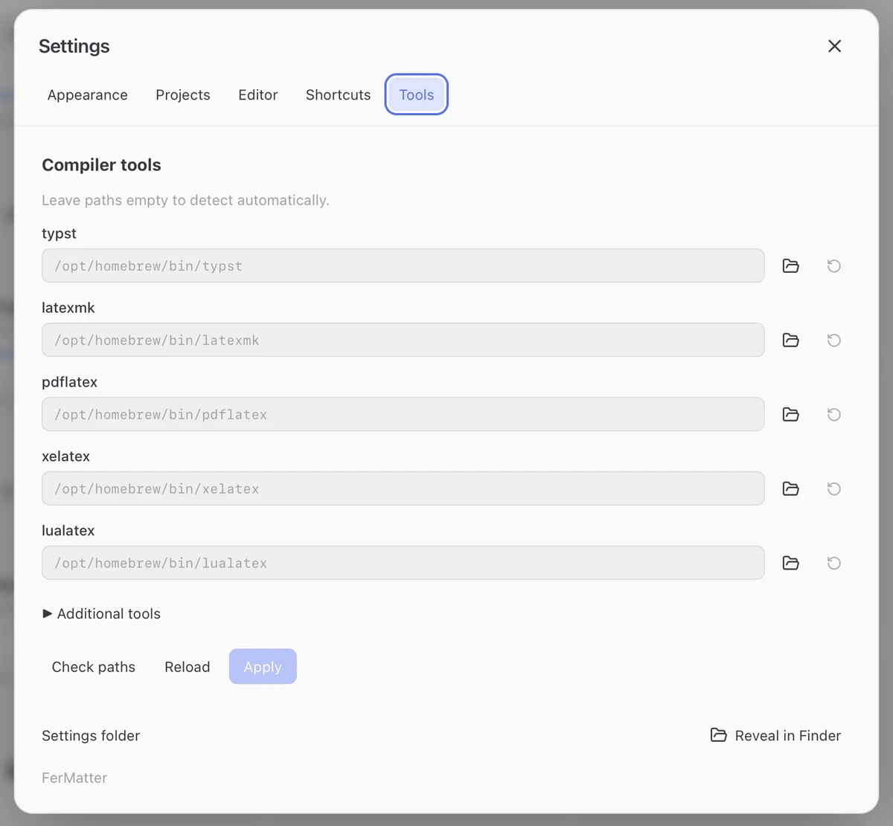

**Apple Silicon · macOS 14+**, or **Windows 11 · x64**. Install LaTeX or Typst separately.

Windows installer and rendering tools: [Windows installation](https://fermatter.github.io/download/#windows). The installer includes WebView2 runtime setup; Node.js, Rust and Python are not required to run the app.

Experimental Ubuntu 24.04 amd64 packages and rendering-tool commands: [Ubuntu installation](https://fermatter.github.io/download/#ubuntu).

## Rendering tools

Install the tools for your source format; they are separate from the FerMatter app.

| Project | Required tools | Installation |
| --- | --- | --- |
| Typst / CeTZ | Typst CLI 0.14+ | [macOS](https://fermatter.github.io/download/#typst) · [Windows](https://fermatter.github.io/download/#windows) |
| LaTeX / TikZ | TeX engine, `latexmk`, `preview.sty`, `pdfcrop`, Poppler (`pdftocairo`, `pdfinfo`) and SyncTeX; `pdf2svg` on macOS/Linux | [macOS](https://fermatter.github.io/download/#install) · [Windows](https://fermatter.github.io/download/#windows) |
| DVI-based LaTeX | LaTeX tools above, plus `dvips` and Ghostscript | Use the LaTeX installation above |

Project packages/fonts remain required. LaTeX PDF navigation uses SyncTeX.

Windows uses Poppler for SVG conversion. TinyTeX and TeX Live include the Windows Perl and Ghostscript helpers used by LaTeX rendering. See [Windows rendering-tool setup](https://fermatter.github.io/download/#windows).

Recoverable project deletion and the screen color eyedropper are unavailable on Windows; project files can be managed in Explorer.

## Tool discovery

1. Open **Settings → Tools** to see automatically detected executable paths.
2. Use **Check paths** to check the configured tools.
3. To override detection, set an executable path and **Apply**. Clear the override to restore automatic detection.

## Project settings

Open **Project Settings** to choose the main file. For LaTeX, also choose the compiler; **project** follows the project's build configuration.

## Extraction limitations

- FerMatter extracts literal equations and drawings from source files, including supported `input`/`include` paths.
- Equations generated by macros or loops, and document-wide Typst state, may need manual adjustment for isolated rendering.
- A PDF alone cannot be imported as an equation project; keep the LaTeX or Typst source and its resources together.

To omit tables or custom environments from the Library, see [Card extraction](extraction.md) (next release).

## If rendering fails

- A missing executable: check **Settings → Tools** and the installation for your source format.
- A compiler error: open the failed item's log, then check the main file, compiler, packages and fonts.
- Missing equations or an outdated PDF after source edits: [refresh the Library and PDF](paper-to-slides.md#refresh-after-changes).
