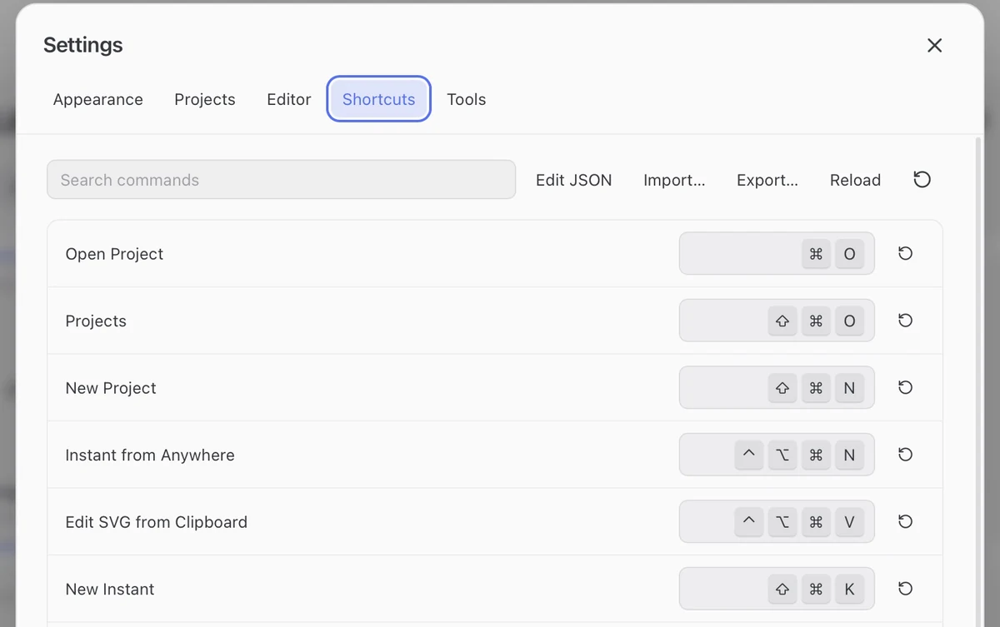

Modify keybindings in **Settings → Shortcuts** (`⌘,`). On Windows, `⌘` corresponds to **Ctrl**, `⌥` to **Alt**, `⇧` to **Shift**, and `⌃` to **Win**.

## Essential shortcuts

| Command | macOS | Windows |
| --- | --- | --- |
| **Copy Image** | `⇧⌘C` | `Ctrl+Shift+C` |
| **Export Image** | `⇧⌘S` | `Ctrl+Shift+S` |
| **Edit Selected Card** | `⌘E` | `Ctrl+E` |
| **Toggle Library / Source** | `⌥⌘E` | `Alt+Ctrl+E` |
| **Toggle PDF View** | `⌥⌘P` | `Alt+Ctrl+P` |
| **Format Source** | `⇧⌥F` | `Shift+Alt+F` |
| **Project Instant** | `⇧⌘K` | `Ctrl+Shift+K` |
| **Global Instant** | `⌃⌥⌘N` | `Win+Alt+Ctrl+N` |
| **Edit SVG from Clipboard** | `⌃⌥⌘V` | `Win+Alt+Ctrl+V` |

Global Instant and Edit SVG from Clipboard require FerMatter to be running.

## Interface zoom

- Global zoom: `⌘+` / `⌘−` / `⌘0` (reset).
- Pane zoom (Projects, Library, PDF): **Control + scroll** over the target area.
- PDF fit shortcuts: `⌃⌘+` / `⌃⌘−` / `⌃⌘0`.

## Keybinding files

Import, export, or reload configuration files (`keybindings.json`) directly within **Settings → Shortcuts**. Color themes use independent [theme files](appearance.md#theme-files).
