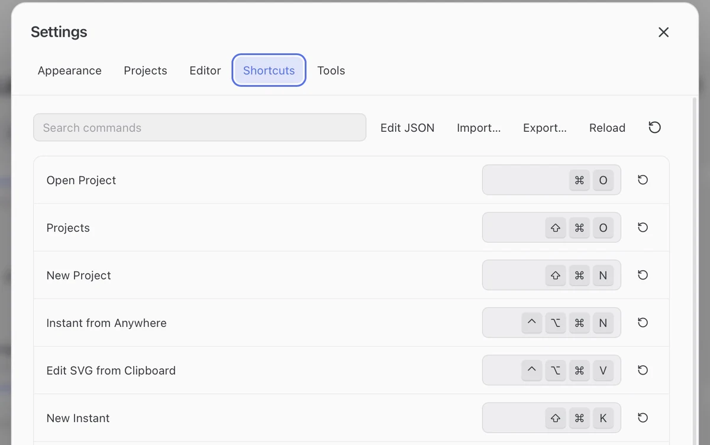

## Customize a shortcut

1. Open **Settings** (`⌘,`) and choose **Shortcuts**.
2. Search for a command and click its assignment to record a new one.
3. Use the row's reset button to restore its default. Duplicate and reserved assignments are rejected.

## Common commands

| Action | Default |
| --- | --- |
| Copy / Export image | `⇧⌘C` / `⇧⌘S` |
| Edit the selected Library card | `⌘E` |
| Toggle Library / Source | `⌥⌘E` |
| Toggle PDF | `⌥⌘P` |
| Format source | `⇧⌥F` |
| New Instant for the current workspace | `⇧⌘K` |
| Instant from Anywhere, with FerMatter running | `⌃⌥⌘N` |
| Edit SVG from Clipboard, with FerMatter running | `⌃⌥⌘V` |

## Window zoom

`⌘+` / `⌘−` / `⌘0` zoom or reset the whole interface.

## Zoom one pane

| Pane | Controls |
| --- | --- |
| Projects or Library | **Control + scroll** over the pane |
| PDF | **Control + scroll**, or `⌃⌘+` / `⌃⌘−` / `⌃⌘0` (Fit) |

Display zoom is separate from [output size](export.md#output-size).

## Shortcut files

In **Settings → Shortcuts**, **Edit JSON / Reload / Import… / Export…** manages `keybindings.json`. Invalid files keep the last valid settings. Color palettes use a separate [theme file](appearance.md#theme-files).
